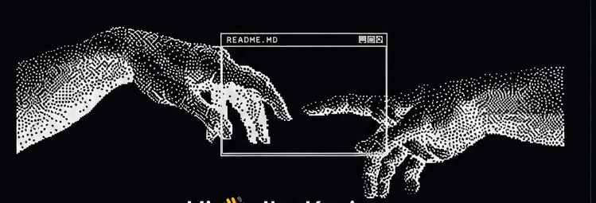
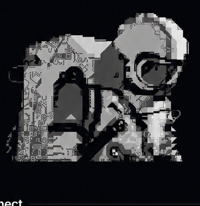

  

<h1 align="center">Hi 👋, I'm Kevyn Sena</h1>

<h3 align="center">Full-Stack Developer · Systems Engineer</h3>

  

  

  Open to full-stack, backend and systems roles (remote or Colombia).

<h2 align="center">🚀 About Me</h2>

I'm a Systems Engineer from Universidad de Córdoba (Montería, Colombia), graduated in July 2026 and focused on full-stack development.

I work with a planning-first approach: I document requirements and design the architecture before writing code, then turn that groundwork into real, working applications.

I completed a 120-hour **Diplomado en Desarrollo de Aplicaciones Web con Herramientas Cloud** (Unicordoba, 2026).

My goal is to keep learning, build useful software, and grow into a well-rounded engineer who creates reliable solutions.

 

<h2 align="center">🛠️ Projects</h2>

### 💧 [HydrApp](https://github.com/veksir/hydrapp)
Hydration-tracking PWA with an AI assistant powered by the Groq API and push notifications.
**Stack:** React, Vite, Express, SQLite, Groq API · **Deploy:** Vercel (frontend) + Render (backend)
🔗 [Live demo](https://hydrapp-beta.vercel.app) · The backend runs on a free tier, so the first request after inactivity may take a few seconds.

### 🎯 [flexgoal](https://github.com/veksir/flexgoal)
Goal-tracking mobile app with weekly and daily views.
**Stack:** React Native, Expo

### ✈️ [Airport Staffing Calculator](https://github.com/veksir/dimensionamiento-personal-aeropuerto)
Tool that calculates the staff required per day and station from a flight itinerary spreadsheet, and generates result spreadsheets plus an HTML dashboard. Packaged as a Windows executable for non-technical users. Tested with real itineraries covering 55 stations.
**Stack:** Python, Excel, HTML

### 🧾 [SIGSA](https://github.com/veksir/sigsa)
Management system for an auto repair shop.
**Stack:** PHP, MySQL

### 🎓 [Automated Attendance System](https://github.com/bambai-labs/asistencia-unicordoba)
Team project at Unicordoba for automated attendance tracking. My role focused on functional testing.
**Stack:** React, Node.js, MongoDB, Docker

<h2 align="center">💻 Tech Stack</h2>

<b>Languages</b>

  

<b>Frameworks & Libraries</b>

  

<b>Databases & Tools</b>

  

<h2 align="center">🤝 Connect</h2>

  
  &nbsp;&nbsp;&nbsp;
  
  &nbsp;&nbsp;&nbsp;
  

  🌐 <a href="https://kevynsena.vercel.app">Portfolio</a>

